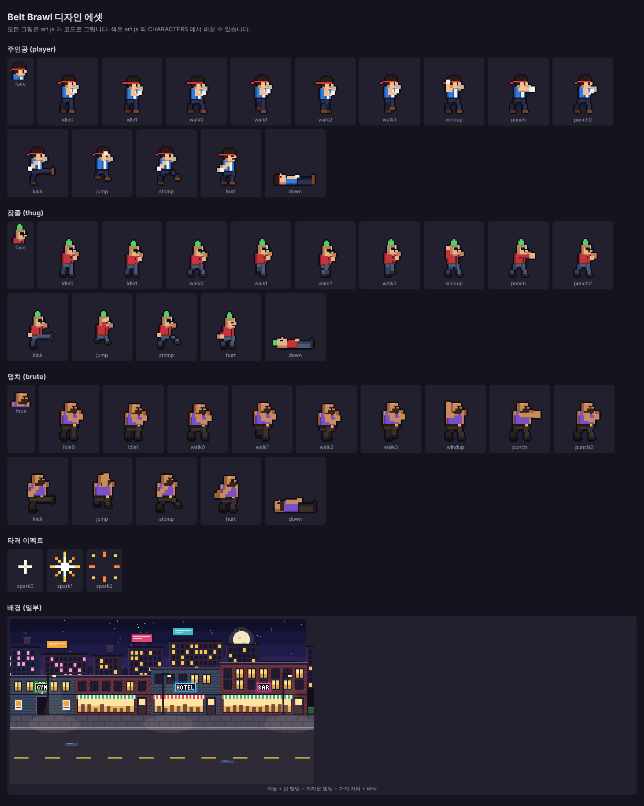

# Belt Brawl — 벨트스크롤 액션 실험

파이널 파이트, 더블 드래곤 같은 횡스크롤 격투(벨트스크롤) 게임을 만드는 실험입니다.
설치할 것 없이 브라우저만 있으면 돌아갑니다.

| 파일 | 내용 |
|---|---|
| `index.html` | 게임 본체 |
| `art.js` | 디자인 에셋. 캐릭터·배경·이펙트 픽셀아트를 코드로 그림 |
| `assets.html` | 에셋 모아보기 페이지 |
| `assets-sheet.png` | 에셋 모아보기 캡처 이미지 |
| `data/enemies.js` | 적 종류별 능력치 (체력·속도·데미지·점수·그림·넘어뜨림) |
| `data/waves.js` | 웨이브 구성 (어디서 몇 명, 어떤 적) |
| `data/feel.js` | 타격감 숫자 (멈춤·화면 밀림·밀려남·번쩍임) |

## 실행하는 법

`index.html` 파일을 더블클릭해서 브라우저(크롬, 엣지, 사파리)로 엽니다. `art.js` 와 `data` 폴더가 같은 폴더에 있어야 합니다.

## 조작

| 동작 | 키 |
|---|---|
| 이동 (앞뒤 + 위아래 깊이) | 방향키 또는 WASD |
| 공격 (3연타, 세 번째는 강타로 넘어뜨림) | Z 또는 J |
| 점프 | X 또는 K |
| 시작 / 재시작 | Enter |

휴대폰에서는 화면을 탭해서 시작합니다. 왼쪽 화면을 누른 채 끌면 이동, 오른쪽의 공격·점프 버튼을 누릅니다.
가로로 돌려서 하는 것이 편합니다.

## 지금 들어 있는 것 (v0.2)

- 깊이가 있는 바닥 위를 8방향으로 걷기, 깊이(위아래)가 비슷해야 서로 맞음
- 3연타 콤보, 마지막 타는 적을 넘어뜨림. 넘어진 적은 잠시 무적
- 적 2종: 잡졸(빨강, 빠르고 약함), 덩치(보라, 느리고 세고 맞으면 넘어짐)
- 적은 플레이어 옆자리로 다가와 팔을 뒤로 당기는 예비 동작 뒤에 공격
- 웨이브 3개. 다 잡으면 "GO →"가 깜빡이고 오른쪽으로 가면 다음 웨이브
- 체력바, 점수, 타격 이펙트와 화면 흔들림
- 체력 0이면 게임오버, 3웨이브 클리어하면 스테이지 클리어
- 모바일 터치 조작 (가상 조이스틱 + 공격·점프 버튼)
- 픽셀아트 그래픽: 캐릭터 3종 × 동작 13개, 밤거리 배경 5겹(하늘·먼 빌딩·가까운 빌딩·가게 거리·도로), 타격 이펙트, 레트로 글꼴

## 디자인 에셋

- 주인공: 빨간 머리띠, 파란 조끼. 3연타는 왼손 잽 → 오른손 스트레이트 → 발차기
- 잡졸: 초록 모히칸, 선글라스, 빨간 재킷
- 덩치: 대머리, 수염, 보라 민소매
- 적은 공격 전에 주먹을 뒤로 크게 당긴다. 이게 피하라는 신호
- 색을 바꾸려면 `art.js` 의 `CHARACTERS` 안 `c:` 목록에서 색 코드를 고치면 된다

## 숫자 바꾸는 곳

`index.html` 안에서 찾으면 됩니다. 코드를 몰라도 숫자만 바꾸면 반영됩니다.

- `WAVES` — 웨이브마다 나오는 적의 수와 종류, 어디서 시작되는지(`lockX`)
- `ENEMY_TYPES` — 적의 체력(`hp`), 속도(`speed`), 공격력(`dmg`), 점수(`score`)
- `player` 안의 `hp: 100`, `speed: 3.2` — 플레이어 체력과 속도

## 다음에 할 만한 것

- 잡기/던지기, 필살기(체력 소모)
- 보스
- 효과음과 배경음악
- 보스 전용 그림
